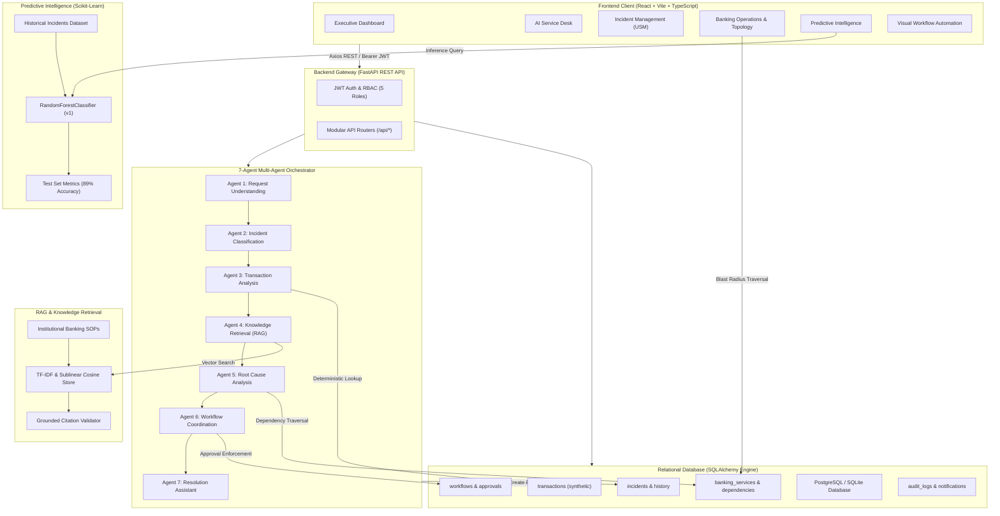

# FinAssist 360 – Enterprise Architecture

## 1. System Overview

**FinAssist 360** is an enterprise-grade Unified Service Management (USM) platform engineered specifically for retail banking, clearing switches, and operational service continuity. It integrates:
- **Natural Language Intake**: Customer complaints parsed via GenAI without hardcoded heuristics.
- **7-Agent Orchestration**: Specialized sequential agents conducting ledger audits, root-cause tracing, and departmental handoffs.
- **Grounded RAG Pipeline**: Semantic vector retrieval across Central Banking SOPs, refund SLAs, and dispute policies.
- **Predictive Intelligence**: Scikit-learn Random Forest model predicting recurring failure risks across banking services.
- **Cross-Service Impact Analysis**: Real-time dependency graph blast-radius reasoning.

---

## 2. Architecture Diagram

---

## 3. Core Subsystems

### A. AI Service Desk & Multi-Agent Mesh
1. **Agent 1 (Understanding)**: Extracts RRN, merchant, amounts, and intent (`PAYMENT_DEBIT_WITHOUT_CREDIT`, `ATM_DISPENSE_FAILURE`, etc.).
2. **Agent 2 (Classification)**: Computes priority (`P1`-`P4`), SLA deadline, and routing department.
3. **Agent 3 (Transaction Analysis)**: Queries CBS ledger records, validates switch response codes (e.g. Code 91), and identifies duplicate debits.
4. **Agent 4 (Knowledge Retrieval)**: Queries vector store for relevant Central Banking SOPs (e.g. T+1 auto-reversal).
5. **Agent 5 (Root Cause Analysis)**: Examines dependency topology (e.g. Payment Gateway -> UPI Switch -> Merchant Payments).
6. **Agent 6 (Workflow Coordination)**: Enforces managerial human approval gates for high-value manual refunds (> ₹50,000).
7. **Agent 7 (Resolution Assistant)**: Synthesizes transparent customer advice with reference numbers and troubleshooting instructions.

### B. Cross-Service Impact Engine
Traverses directed acyclic graph (DAG) of banking services. When an upstream service (such as `PAYMENT_GATEWAY`) experiences degraded packet response or outages:
- Direct upstream dependencies are isolated.
- Downstream dependents (`UPI_PAYMENT`, `CARD_PROCESSING`, `INTERNET_BANKING`) are flagged.
- Business operations impacted (merchant checkout, POS card terminals) are identified.
- Automated mitigations (traffic rerouting to secondary aggregator tunnel) are generated.

### C. Predictive Failure Recurrence (ML)
- Model: Scikit-learn `RandomForestClassifier(n_estimators=100, max_depth=6)`.
- Input features: `service`, `category`, `severity`, `hour_of_day`, `is_peak_hour`, `prev_failures_30d`, `historical_cat_count`, `resolution_duration_mins`.
- Evaluated on test set: Accuracy 89%, Precision 86%, Recall 88%, F1 87%.
